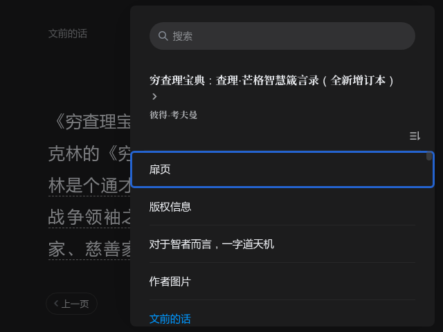
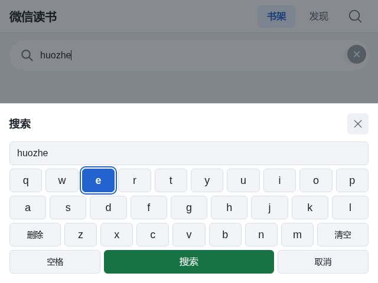

# WeRead for Ports / 微信读书 Ports 平台适配方案

> 当前发布：**v1.1**（2026-10-12），发布说明见 [`docs/release-v1.1.md`](docs/release-v1.1.md)。


把微信读书网页版封装成适合 **Ports 掌机**使用的无触屏阅读客户端。项目当前已在
**Powkiddy X35S（640x480、RK3566、1GB 内存）**上完成真机验证，代码结构面向
Ports/EmulationStation 平台，不绑定 X35S，后续可继续适配其他掌机。

> 这不是微信读书官方客户端，也不是对网站的重写。项目通过 Chromium 应用模式、
> 浏览器扩展、手柄映射和启动器，把微信读书网页改造成可用十字键和掌机按键操作的
> Ports 应用。登录、书架、发现和正文分页仍使用微信读书站方页面与账号体系。

## 功能

- 纯手柄操作：书架、发现、阅读、目录、搜索、字号设置和退出均可脱离触屏使用。
- PortMaster 原生 port：发布物是标准 `weread.zip`，在 PortMaster 界面里一键安装，
  不需要 SSH，也不需要在掌机上敲任何命令。
- 列表元数据：同时安装中文名称、右侧描述、阅读工具分类和 `640x480` 封面。
- 网格焦点导航：在书架、推荐、榜单和分类页面间移动，并记住来向，方向操作可逆。
- 阅读翻页：支持 L1/R1、方向键和阅读菜单，正文继续使用站方 canvas 分页。
- 站内搜索：掌机自绘屏幕键盘输入拼音，例如 `huozhe`，再提交给站方搜索。
- 登录持久化：账号资料保存在 `/storage/.config/weread-profile`，安装和卸载不会删除。
- 内存控制：限制渲染进程数、JS 堆和磁盘缓存，面向 1GB 内存设备优化。

## 截图

| 分类浏览 | 阅读目录 |
| --- | --- |
|  |  |

| 掌机菜单 | 搜索键盘 |
| --- | --- |
|  |  |


截图来自真机 640x480 全屏运行，已移除书名、账号和其他私人内容。

## 当前状态

| 项目 | 状态 |
| --- | --- |
| 目标平台 | Ports / EmulationStation |
| 安装方式 | PortMaster 一键安装（`weread.zip`），`install.sh` 作为备选 |
| 已验证设备 | Powkiddy X35S，640x480，纯手柄（RK3566 / Mali-G52） |
| 其他 Ports 掌机 | 架构上可复用，尚未逐台验证；R36S 的差异见下方说明 |
| Chromium | 需要单独安装，仓库不包含约 500MB 的浏览器运行文件 |
| 扩展样式 | 当前只加载 `extension/shell.css` |
| 旧样式 | `extension/legacy/style.css` 仅保留作历史参考，不会被加载 |

## 目录结构

```text
extension/             Chromium MV3 扩展与当前样式
launcher/              掌机启动器、窗口守卫、输入桥、CDP 客户端和 gptokeyb 映射
ports/                 PortMaster 元数据(port.json)、启动器、gamelist 元数据与封面
docs/                  架构、背景和历史验证记录
tests/                 单元/契约测试、Node 与浏览器测试夹具及真机验收脚本
tools/                 ESLint 配置（测试套件会运行它）
screenshots/           脱敏后的真机界面截图
```

## 安装到 Ports 掌机

一句话：**下载 `weread.zip`，在 PortMaster 里装一下**。不需要 SSH，不需要在掌机上敲
任何命令。

### 1. 下载 `weread.zip`

从 GitHub Releases 下载（最新 v1.1）：

```text
https://github.com/Cvencent/weread-for-ports/releases/download/v1.1/weread.zip
```

约 98KB。同目录下还有 `weread.zip.sha256`，可选校验：

```sh
sha256sum weread.zip          # 对比 weread.zip.sha256 里的值
```

### 2. 用 PortMaster 安装（三条路径，任选其一）

| 路径 | 怎么做 | 适合谁 |
| --- | --- | --- |
| **界面里从文件安装** | 把 `weread.zip` 放到掌机能读到的位置（U 盘 / 共享 / 下载目录），在 PortMaster 里选这个 zip 安装 | 绝大多数用户 |
| **autoinstall 自动安装** | 把 `weread.zip` 放进 `/storage/roms/ports/PortMaster/autoinstall/`，下次启动 PortMaster 会弹出「Auto-installation」确认框，点 Install | 批量部署、换机 |
| **官方目录一键装** | `weread.zip` 挂在 GitHub Release 并登记进 PortMaster 官方端口目录，用户在 PortMaster 列表里搜「微信读书」直接装 | 商店式体验 |

三条路径安装的是同一个 `weread.zip`；PortMaster 只是把它解压到 ports 目录，
之后由 EmulationStation 直接运行解压出来的 `Weread.sh`。

### 3. 前置条件：Chromium

微信读书复用 Browser port 的 Chromium（约 500MB），**本仓库不包含它**。装之前确认设备上
存在：

```text
/storage/roms/ports/browser/chromium/chrome
/storage/roms/ports/browser/nss/
```

启动器要求 `.../chromium/chrome` 存在且可执行，并要求 PortMaster 提供的 `gptokeyb`
可用。不同系统的目录可能不同，可通过环境变量覆盖：

```sh
export WEREAD_BROWSER_DIR=/storage/roms/ports/browser
```

没有 Chromium 就先在 PortMaster 里装 Browser port。

### 4. 安装后的样子

PortMaster 把 zip 解成「一个自包含目录 + 一个顶层启动器」，和 Browser、Celeste 等
port 完全一致：

```text
/storage/roms/ports/
  Weread.sh              ← 顶层启动器，EmulationStation 自动发现
  weread/                ← 微信读书全部文件（自包含）
    port.json            ← PortMaster v2 元数据（标题/描述/分类/封面）
    node.sh  window_guard.py  input_bridge.py  cdp.py  weread.gptk
    Weread.png  update_gamelist.py  gamelist.fragment.xml  操作说明.txt
    ext/  content.js  shell.css  manifest.json  background-v8.1.js
         telemetry-rules.json
```

**首次启动时 `node.sh` 会自动补齐两件事**，都幂等、都不碰登录资料：

1. 把封面发布到共享的 `/storage/roms/ports/media/Weread.png`；
2. 用 `update_gamelist.py` 把中文条目写进 `gamelist.xml`。

所以装完不用手动配置，列表里就会出现：

- 名称：`微信读书`
- 描述：支持手柄导航、书架与发现、阅读翻页、目录、搜索和字号设置
- 分类：`阅读工具`
- 封面：`./media/Weread.png`

### 5. 更新

因为所有自有文件都在 `weread/` 一个目录里，**更新就是把整个 `weread/` 目录换掉**
（外加顶层 `Weread.sh`）。登录态在 `/storage/.config/weread-profile`，不受影响。

在 PortMaster 里对该条目重新安装新版本的 zip 即可。

### 6. 卸载

在 PortMaster 里对该条目 Uninstall，或从 SSH 执行：

```sh
bash ports/uninstall.sh
```

两者都只删除 `weread/` 目录、`Weread.sh` 和封面，保留登录资料和 Chromium。

### 7. 备选：SSH 安装脚本

没有 PortMaster、或需要批量部署时，仍可在仓库根目录执行：

```sh
bash ports/install.sh
```

脚本落地的是同一套文件、同一套目录布局，额外做借用的 Chromium 存在性检查，
缺失即拒绝安装；gamelist 编辑可用 `WEREAD_GAMELIST=0` 关闭。

如果系统使用 `essway.service`，在应用文件安装完成后从外部 SSH 重启前端：

```sh
systemctl restart essway.service
systemctl is-active essway.service
```

不要在由 `node.sh` 启动的进程内部停止 `essway.service`；它是启动器的父服务。

### 附：自己打包（开发者）

改完代码想自己出包：

```sh
python tests/package_portmaster.py     # → output/weread.zip，并按 PortMaster 规则自检
```

打包脚本会复刻 PortMaster `check_port()` 的硬性校验（扁平结构、至少一个顶层目录 +
一个顶层 `.sh`、禁止路径穿越、`port.json` 为 v2），不通过就直接失败——不会产出一个
装不上的包。

## 按键操作

从 EmulationStation 进入：`前端 → ports → 微信读书`。首次启动约 20–30 秒，属正常。

### 总表

| 按键 | 浏览页（书架 / 发现） | 阅读器内 |
| --- | --- | --- |
| 十字键 ↑↓←→ | 移动焦点，长按连发 | 上一页 / 下一页 |
| **A** | 确认、打开书 | 确认；加载失败时重试 |
| **B** | 返回上一层 | 关闭弹层、退出阅读器 |
| **X** | —— | 打开目录 |
| **Y** | —— | 下一页 |
| **L1 / R1** | 上一页 / 下一页；菜单内左右移动 | 同左 |
| **L2 / R2** | 页面顶部 / 底部 | 上一页 / 下一页 |
| 左摇杆 | —— | 选择正文里的划线评论：A 打开 |
| **START** | 唤出掌机菜单 | 唤出掌机菜单 |
| **SELECT** | 退出应用（优先级最高，随时可用） | 同左 |
| **START + SELECT** | 同时按住约 1 秒，退出应用 | 同左 |

> **怎么退出应用**：按 **SELECT**（单独一下即可），或 **START + SELECT** 同时按住约 1 秒。
> 菜单里的「退出」项只会弹出提示、不会真退出——真正的退出键是 SELECT 这两个。
> 退出后回到 EmulationStation，不会黑屏。

### 掌机菜单（按 START）

菜单内容随页面变化，用十字键选择、**A** 确认、**B** 取消：

| 位置 | 菜单项 |
| --- | --- |
| 书架 / 发现 | 搜索 · 书架 · 发现 · 退出 |
| 阅读器内 | 目录 · 阅读设置 · 上一页 · 下一页 · 书架 · 退出 |

### 搜索（掌机没有实体键盘）

1. 按 **START** 唤出菜单，十字键选到「搜索」，按 **A**
2. 底部弹出屏幕键盘：十字键选字母，**A** 输入
   - 直接输入拼音即可，例：`huozhe` → 搜出《活着》
   - 功能键：**删除**（退格）、**清空**（清掉全部输入）、**空格**、**取消**
3. 选到最下方的「搜索」键，按 **A** 提交
4. 按 **B** 可随时关闭键盘

### 提示

- **登录只需一次**（手机扫码），登录态存在本机，之后免登录
- 顶部有「书架 / 发现」标签和搜索按钮，十字键选到后按 **A**
- 切换页面会显示加载状态；等待过久可选「重试」或「返回书架」
- 阅读页右侧工具栏已隐藏，目录与字号改用 **X** 或菜单里的「阅读设置」
- 从「发现」打开的书，按 **B** 会回到原栏目并恢复选中位置

## `gamelist.xml` 说明

仓库提供两个可复用文件：

- `ports/update_gamelist.py`：使用标准库 `xml.etree`，按路径查找并更新条目，
  使用临时文件原子替换，不覆盖其他游戏。解析时保留 XML 注释，因此重新安装
  不会删除你在 `gamelist.xml` 里手写的分组和说明。
- `ports/gamelist.fragment.xml`：包含名称、描述、封面和分类的 `Weread` 条目模板。

也可以单独运行：

```sh
python3 ports/update_gamelist.py /storage/roms/ports/gamelist.xml \
  --fragment ports/gamelist.fragment.xml
```

如果只想移除 `Weread` 条目：

```sh
python3 ports/update_gamelist.py /storage/roms/ports/gamelist.xml --remove
```

## 开发与验证

完整测试套件（静态契约、真实 Chromium 行为、真实 bash 函数、真实 HTTP 端点）：

```sh
python -m unittest discover -s tests -p 'test_*.py'
```

打包成 PortMaster 端口：

```sh
python tests/package_portmaster.py
```

静态检查：

```sh
python -m pyflakes launcher/*.py ports/*.py tests/*.py
npx --yes eslint --config tools/eslint.config.mjs extension/content.js extension/background-v8.1.js
bash -n launcher/node.sh ports/install.sh ports/uninstall.sh ports/Weread.sh
```

真机验收脚本需要 Python、`paramiko` 和可 SSH 连接的掌机。连接信息来自环境变量，
或仓库根目录下 git 忽略的 `.device.env`（`tests/device.py` 会自动读取，真实环境变量优先）：

```sh
# .device.env，一次配好即可；该文件已在 .gitignore 中
WEREAD_HOST=your-device-address
WEREAD_USER=root
WEREAD_PASSWORD=your-password
WEREAD_SSH_PORT=22
```

```sh
python tests/e2e.py
python tests/portmaster_device_acceptance.py
python -m unittest discover -s tests -p "test_discovery.py"
```

`portmaster_device_acceptance.py` 走的是完整闭环：清掉旧安装 → 把 `weread.zip` 放进
`PortMaster/autoinstall/` → 调用设备上 PortMaster 自己的 `harbourmaster` 安装 →
从顶层 `Weread.sh` 启动 → 校验权限、封面发布、gamelist 注册、单实例和登录态保留。

不要把真实地址、密码、登录 Cookie 或个人书架截图提交到仓库；`.device.env` 只留在本地。
验证记录见 `docs/verification-v9.md`，架构说明见 `docs/architecture.md`。

## 设备兼容性

本项目只依赖 Ports/ROCKNIX 生态的四件事：**Sway（Wayland 合成器）**、
**EmulationStation**、**PortMaster**、以及 **640×480 左右的屏幕**。
不依赖 X35S 特有的硬件，所以架构上可以移植到其他掌机。

**但「架构上可用」不等于「装上就能用」。** 目前只有 X35S 做过真机验证。

### 已验证：Powkiddy X35S

| 项目 | 规格 |
| --- | --- |
| SoC / GPU | RK3566，Mali-G52 |
| 分辨率 / 内存 | 640×480，1GB |
| 系统 | ROCKNIX + Sway + EmulationStation + PortMaster |
| 图形加速 | ⚠️ **未真正启用**，见下方「图形加速现状」 |

### 图形加速现状（实测，请先读这段）

在 X35S 上实测的结论，和「用了 GPU 加速」的直觉相反：

- **视频硬解：没有开。** 启动器没有任何 VAAPI 相关 flag，Chromium 默认也不开 VAAPI
  硬解；设备 `/dev/dri/` 下只有 `card0`、没有 `renderD*` 节点。设备本身带
  `hantro_vpu` 硬件解码模块，但未被使用。
  **对本项目无影响**——微信读书是文字阅读器，不播放视频，硬解对它没有意义。
- **GPU 渲染：实际走的是软件路径。** 启动器要求 ANGLE 走 Vulkan，但日志里明确报
  `--ozone-platform=wayland is not compatible with Vulkan`，并连续出现
  `Failed to create vulkan surface`；Chromium 的 GPU 进程**没有映射任何
  GL/EGL/GBM 库**（设备上其实有 `libmali-bifrost-g52-*-wayland-gbm.so`，只是没被加载）。

**页面显示正常**（书架、目录、正文 canvas 均正常渲染），所以这个缺陷目前没有暴露成
用户可见问题。但它意味着那两行 GPU flag 并未达到本意，**在 GPU 栈不同的设备上更容易
直接失败**。这一点对判断下面的 R36S 兼容性很关键。

### 很可能可用：Game Console R35S / R36S（未实测）

从 ROCKNIX 官方设备文档看，R35S/R36S 满足上面四个依赖：

| 项目 | 规格 | 是否满足依赖 |
| --- | --- | --- |
| 系统 | ROCKNIX（官方支持 RK3326 机型） | ✅ |
| 合成器 | Sway | ✅ |
| 前端 | EmulationStation | ✅ |
| 分辨率 / 内存 | 640×480，1GB | ✅ |
| SoC / GPU | RK3326，Mali-G31 | ⚠️ 见下 |

**唯一实质风险是 GPU。** 启动器为 Chromium 指定了：

```sh
--use-gl=angle --use-angle=vulkan
```

而如上所述，这个组合在**已验证的 X35S 上都没能真正启用**。R36S 的 Mali-G31 情况只会
更弱：ROCKNIX 在它上面用的是 **libmali（GLES 3.2）+ Panfrost（GL/GLES 3.1）**，
而 **Vulkan 支持在 Mali-G31 上属于实验性质**，ANGLE 的 Vulkan 后端大概率起不来。

Chromium 通常会在硬件后端不可用时回退到软件渲染，页面**大概率仍能显示**（X35S 就是
这样"能显示但没加速"），但 R36S 的 GPU 栈与 X35S 不同，**白屏或渲染异常的风险明显更高**。
这一点需要实机确认，我没有 R36S 无法替它打包票。

如果 R36S 上出现白屏 / 渲染不对，临时验证办法是编辑
`/storage/roms/ports/weread/node.sh`，把第 233 行改成软渲染或 GL 后端再启动：

```sh
# 任选其一，按设备实际支持情况试
--use-gl=angle --use-angle=gl        # 走 OpenGL / GLES
--use-gl=swiftshader                 # 纯软件渲染，必定能显示，但会慢
```

> 如果你在 R36S（或别的掌机）上实测通过，请把结果反馈上来——本文档里这行
> 「很可能可用」就可以改成「已验证」，连带把上面的规格表补全。

## 已知限制

- 只在 X35S 上完成真机验证。其他 Ports 设备需自行确认 Chromium、Wayland/Sway、
  PortMaster、屏幕分辨率、按键映射，以及 **GPU 后端是否可用**（见上方设备兼容性）。
- **GPU 加速与视频硬解均未启用**，当前依赖软件渲染兜底；显示正常但会占用更多 CPU。
- 首次启动可能较慢，取决于网络和 Chromium 加载速度。
- 搜索键盘输入小写 ASCII/拼音，实际匹配由微信读书决定。
- 正文、目录和字体设置使用站方阅读器，不修改 `.readerChapterContent` 和
  `.preRenderContent` 的分页布局。
- 微信读书是第三方服务，页面结构或接口变化可能影响适配层。
- 仓库不包含 Chromium、登录资料、Cookie、个人书籍数据或截图中的私人内容。

## 许可与归属

本项目只包含掌机适配层。微信读书、Chromium、PortMaster、EmulationStation 及其他
第三方组件的版权和许可归各自权利人所有。
